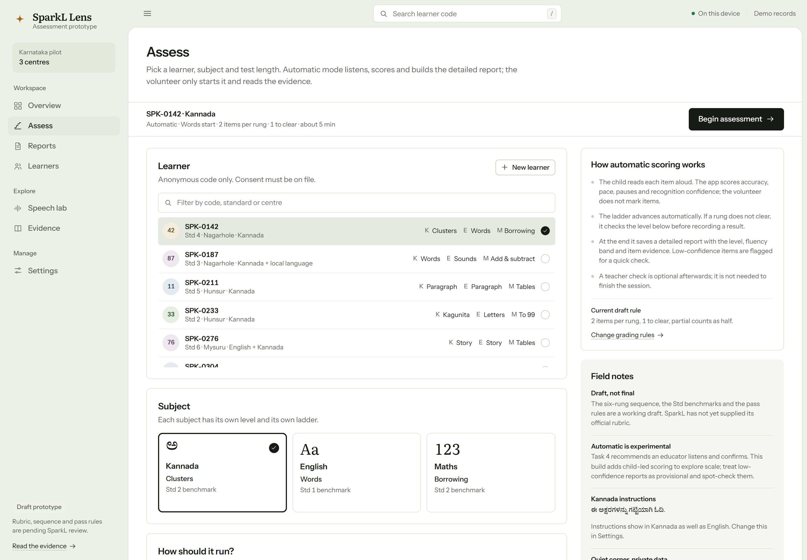
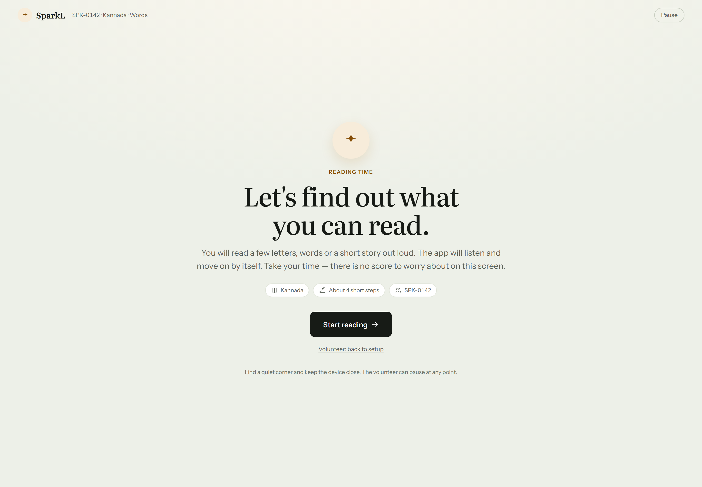
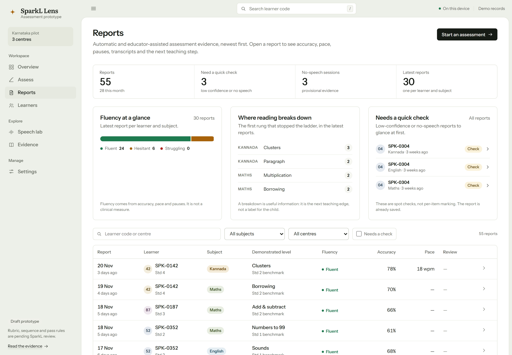
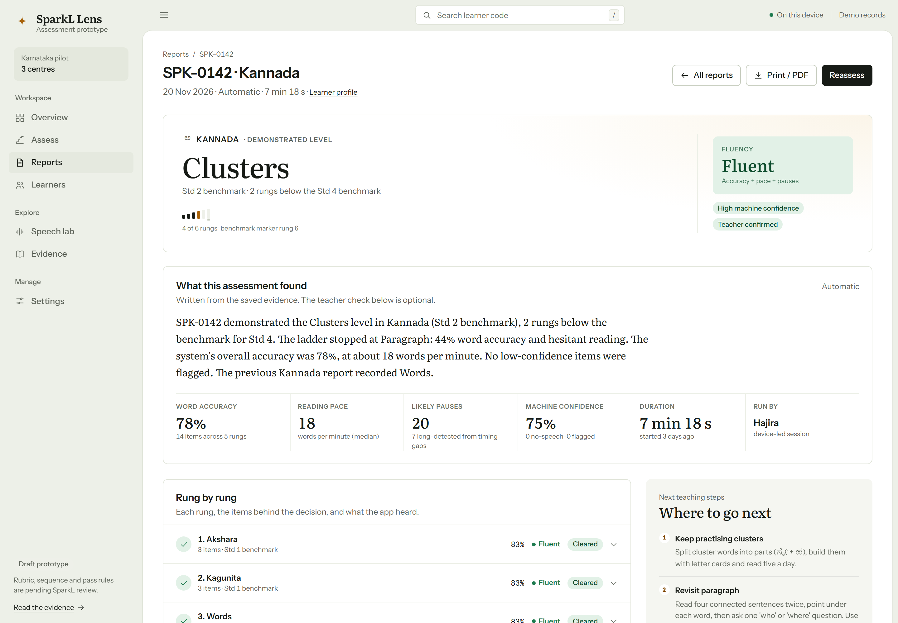
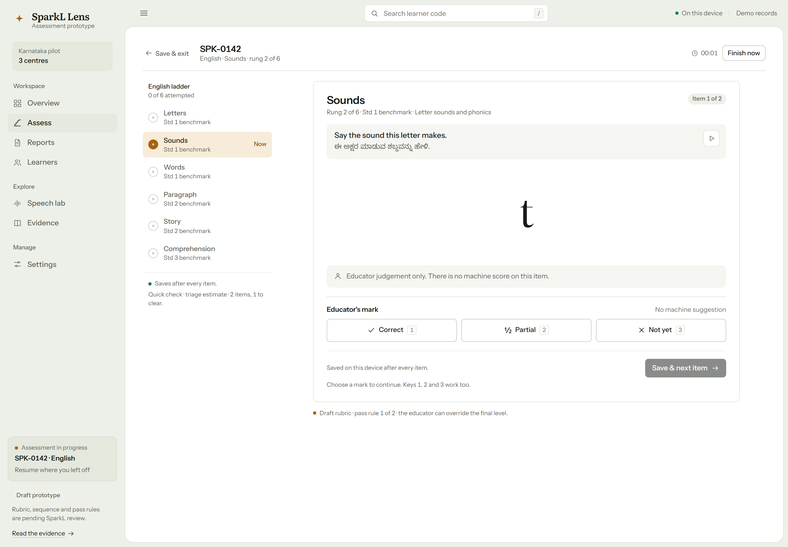
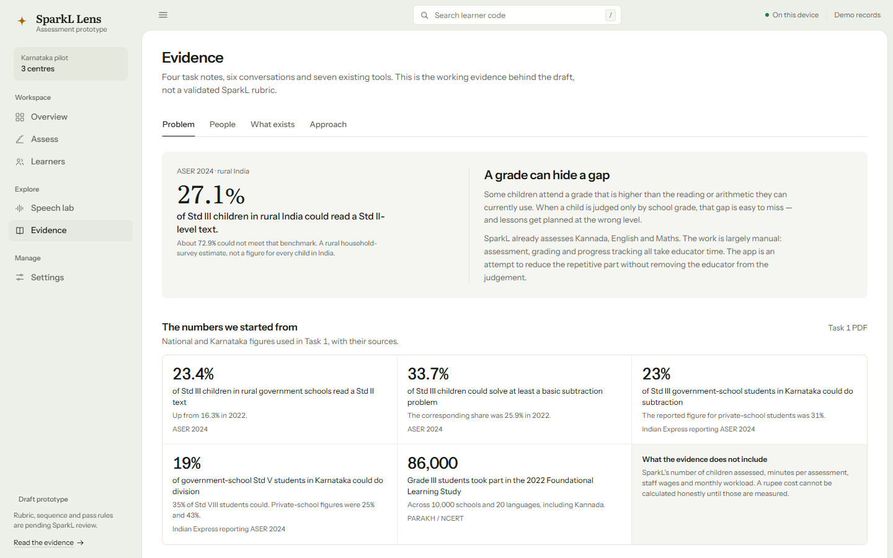
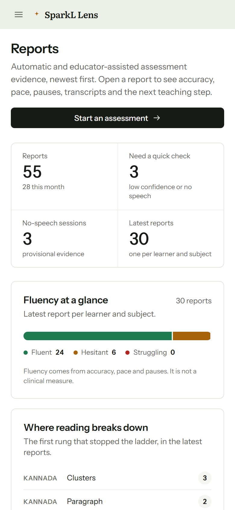
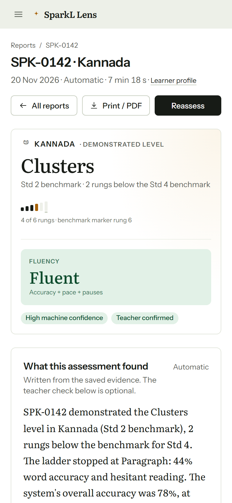

# SparkL Lens

A local-first assessment app for **Project SparkL**. It finds a child's demonstrated level in **Kannada, English and Maths**, scores the attempt automatically, and turns the evidence into a report a teacher or volunteer can act on.

The default flow is child-led: the volunteer starts the assessment, the child reads aloud or uses the number pad, and the app scores accuracy, pace and fluency before saving a detailed report. Educator-assisted marking remains available as a calibration and fallback path.

> This is a prototype, not a validated SparkL assessment. The ladder, benchmarks, pass rules and fluency thresholds are a working draft. Automatic speech is experimental, network-dependent and must be spot-checked. The learner records are seeded demo data.

---

## College review: five-minute walkthrough

1. **Overview** — start with the finding: 10 of 10 assessed learners sit below the foundational benchmark for their standard in at least one subject. Point to the widest gaps.
2. **Assess** — choose `SPK-0142`, Kannada and **Automatic (child-led)**. Run the microphone check, point to the draft warning, and press **Begin assessment**.
3. **Child screen** — the child taps **Start reading**, reads the item aloud, and the app moves on by itself. There is no score or marking on this screen. For maths, show the child-operated number pad.
4. **Report** — the saved report shows the demonstrated level, fluency band, word accuracy, pace, likely pauses, machine confidence, the rung-by-rung evidence, the transcript and the next teaching step. Low-confidence items are flagged, not hidden.
5. **Reports dashboard** — filter by learner, subject, centre or “needs a check”. Open a report from the quick-check list, then show the optional teacher confirmation and level adjustment.
6. **Educator-assisted mode** — switch the pacing toggle and mark the first item by hand. This is the offline-friendly calibration path; the report still records the evidence.
7. **Evidence** — open the source PDFs and show how Tasks 1–4 became the product.

Everything shown is demo data stored in the presentation browser. There is no shared account or real child record.

---

## Screens

_Demo build with the seeded cohort._

<p align="center">
  
</p>

| | |
|:---:|:---:|
|  |  |
|  |  |
|  |  |
|  |  |
|  |  |
|  |  |

<p align="center">
  
  
</p>

---

## Tech stack

- React 19 + TypeScript, built with Vite 6.
- No backend, database, analytics or tracking.
- `localStorage` for records; JSON/CSV export for backups.
- Browser Web Speech API for English/Kannada reading capture.
- A child-operated number pad for maths answers and dot counting.
- Locally bundled fonts (Instrument Sans, Literata, Noto Kannada) and the five source PDFs.
- Node 20+ recommended for the build tooling.

---

## Run it

```bash
npm install
npm run dev
```

Open **http://localhost:5173**.

For the built version:

```bash
npm run build
npm run preview
```

Open **http://localhost:4173**.

The app is a static Vite/React app. There is no server, login or external database. Built files are in `dist/`; the five source PDFs and local fonts are copied from `public/`.

---

## What is in it

| Screen | What it does |
| --- | --- |
| **Overview** | Cohort snapshot, learners with the widest gap, level spread, recent reports and the evidence anchor. |
| **Assess** | Choose an anonymous learner, subject, pacing and test length. Automatic is the default; educator-assisted is available for calibration. Includes a browser/microphone/network preflight. |
| **Automatic session** | Child-led, full-screen flow. The child taps to read, the app listens for a fixed window, scores the response, gives neutral feedback and advances. Maths uses a number pad. The volunteer can pause and finish early. |
| **Reports** | Dashboard of every saved report with fluency mix, where reading breaks down, quick-check flags, search, subject/centre filters and print-friendly detail pages. |
| **Report detail** | Narrative summary, demonstrated level, benchmark gap, fluency, accuracy, pace, pauses, machine confidence, rung-by-rung evidence, transcript, reasons and next teaching steps. Includes an optional teacher confirmation, level adjustment and note. |
| **Educator session** | One item at a time. Speech capture is optional and advisory; the educator marks every response, sees fluency/support, and confirms the rung. |
| **Result** | Suggested level, full ladder, item evidence, the point where the ladder stopped, a draft teaching step, and an educator override before saving. Links to the saved report. |
| **Learners** | Anonymous-code directory with subject levels, gaps, centre filters and CSV export. |
| **Learner profile** | Subject cards, a step chart over time, the last report, teaching step, notes and full history. |
| **Speech lab** | A Kannada/English comparison experiment. The educator marks first; a trial is logged and only then is the machine suggestion revealed. |
| **Evidence** | The four task notes made browsable: ASER numbers, stakeholders, interviews, existing tools, case studies, the proposed approach, hard questions and team. |
| **Settings** | Editable pass rule, Kannada instruction toggle, level/benchmark map, item bank with custom items, export, reset/clear and privacy notes. |

The app ships with **12 seeded learners**, **55 seeded reports** and **8 speech trials** so the cohort screens are not empty. The data is fictional. Reset it at **Settings → Data & privacy → Restore demo**, or clear it entirely.

The five PDFs are available from **Evidence → Source notes**, including the Team Syndicate skill map.

---

## How the assessment works

- Each subject has six draft rungs. The sequence is the same ladder used by the educator-assisted mode.
- **Quick check** starts one rung below the latest level, uses 2 items per rung, needs 1 to clear, and stops after 4 rung attempts. It is a triage estimate.
- **Full ladder** starts at rung 1 and uses the editable default (3 items, 2 to clear).
- **Custom test** lets the educator set the start rung, items, pass mark and attempt limit for one child.
- If the first rung is not cleared, the ladder **drops one rung** to check the level below before recording a result. The result keeps the failed rung as the breakdown edge.
- A partial response counts as half a point by default. All of this can be changed in **Settings → Grading**.
- In educator-assisted mode, the **educator confirms or overrides the final level** on the result screen.
- In automatic mode, the app saves the assessment and opens the report when the run ends. A teacher can confirm or adjust the level afterwards; no per-item marking is required during the session.

### Automatic scoring

The automatic path is built for a volunteer starting one child and reading the result later:

- Reading, sounds and comprehension items use the browser's speech recognition. The child taps once to start and again (or waits for the window to close) when finished.
- Maths answers and dot counts use a child-operated number pad, so no speech is needed for those items.
- Accuracy is the matched-word ratio against the expected text, allowing small recognition slips. Maths answers are compared with the expected answer and accepted alternatives.
- Fluency combines accuracy, reading pace, likely pauses and hesitations. The bands are **fluent / hesitant / struggling**.
- Machine confidence combines recognition confidence, coverage and word match. A low-confidence or no-speech item is flagged for a quick human check.
- After each item the app gives neutral feedback only (“Saved”, “Let’s move on”); it does not tell the child whether the answer was right or wrong.
- The report is saved locally and the child is shown a simple completion screen. The volunteer reads the report afterwards.

### Kannada

Kannada has its own sequence rather than English questions in Kannada script:

`akshara → kagunita → simple words → cluster words → paragraph → story`

The akshara, kagunita, word, cluster, paragraph and story items are in `src/data/curriculum.ts`. The sequence is a draft and must be reviewed by a Kannada educator and SparkL. The interface is English; instructions and item content switch to Kannada.

### Speech caveats

- Speech recognition uses the browser's Web Speech API (`kn-IN` and `en-IN`).
- In Chrome this may send microphone audio to the browser vendor's speech service. **SparkL Lens does not record or upload audio**; it stores only the transcript that is returned.
- It may need a network connection. **Offline recognition is not implemented.**
- It needs a secure context (`https://` or `localhost`) and microphone permission.
- It has not been validated on this cohort or device. Treat automatic results, especially low-confidence ones, as provisional evidence.
- The app shows a microphone check before the session. If speech is unavailable, use educator-assisted mode or continue without speech for the affected items.
- The thresholds are draft. They are visible in the report’s “How this was scored” section and in the code.

Recommended for speech testing: Chrome on `localhost`, with microphone permission allowed.

---

## Data and privacy

- Records are stored in **`localStorage`** under `sparkl-lens-db-v1` in this browser profile.
- Only an **anonymous learner code**, enrolled std, centre, home language, consent flag, notes, assessment results, transcripts and derived metrics are stored.
- No names, photographs, dates of birth, audio or server-side data are stored.
- Consent is recorded as a yes/no flag, not as a signed document.
- A shared browser profile means shared records. Use a dedicated device profile, export after a session and clear when the device changes hands.
- Export JSON or CSV from **Settings → Data & privacy**. This prototype does not import a JSON backup.
- The browser's speech service may process audio externally; that is disclosed in the Speech lab, Assess preflight and Settings.

This is a prototype. It is not a production child-data system and has no authentication, sync, recovery or access control.

---

## Project structure

```
src/
  data/
    curriculum.ts    draft ladders and item bank
    evidence.ts      all research content used by the Evidence page
    seed.ts          demo learners, automatic reports and speech trials
  lib/
    autoAssess.ts    transcript scoring, fluency, confidence and summaries
    reporting.ts     report narrative, rung aggregates and teaching plan
    store.ts         localStorage-backed store and actions
    session.ts       ladder/quick/full session helpers
    scoring.ts       transcript matching and numeric answer checks
    selectors.ts     cohort and learner calculations
    useSpeech.ts     Web Speech API, mic level, timing and confidence
    export.ts        CSV/JSON exports
  pages/             Overview, Assess, Session, AutoSession, Reports,
                     ReportDetail, Learners, LearnerDetail, SpeechLab,
                     Evidence, Settings
  components/        shell, item renderer, ladders, modal, toast, chart
public/
  docs/              the five source PDFs
  fonts/             locally served open-source fonts
docs/screens/        README screenshots
```

---

## Prototype limits and next steps

- Obtain SparkL's official rubric, level names, pass rules and borderline rules.
- Have a Kannada educator approve the akshara/kagunita sequence, examples and instructions.
- Validate automatic scoring against educator judgement on real recordings, per language and per item type. Measure false positives, false negatives and the effect of background noise.
- Agree a confidence threshold and a review policy with SparkL before automatic results are used for decisions.
- Test airplane mode, low battery, shared-device use, Kannada rendering, microphone permission and reopening saved reports on the **actual device**.
- Run the full flow with 30–60 children and measure volunteer time saved versus the cost of spot checks.
- Decide the partner school, centre, education board and data/consent process.
- Add import, authentication, safe sync and access control before any field use.

The research behind each of these points is on the **Evidence** screen and in `public/docs`.

---

## Credits

- Built from **Project SparkL — Team Syndicate**, Tasks 1–4 and the Skill Map (October–November 2026).
- Interface: **Instrument Sans**; reading content and level names: **Literata**; Kannada: **Noto Serif Kannada** and **Noto Sans Kannada**. All are open-source and served locally.
- No analytics, no tracking, no remote API calls are made by the app itself. Browser speech recognition is the one feature that may use the browser vendor's online service.

---

© 2026 Team Syndicate — Project SparkL. Prototype for college review; not intended for production use.
