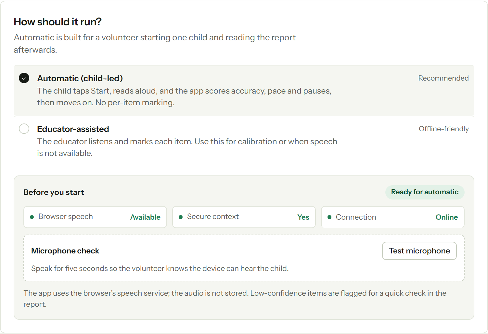
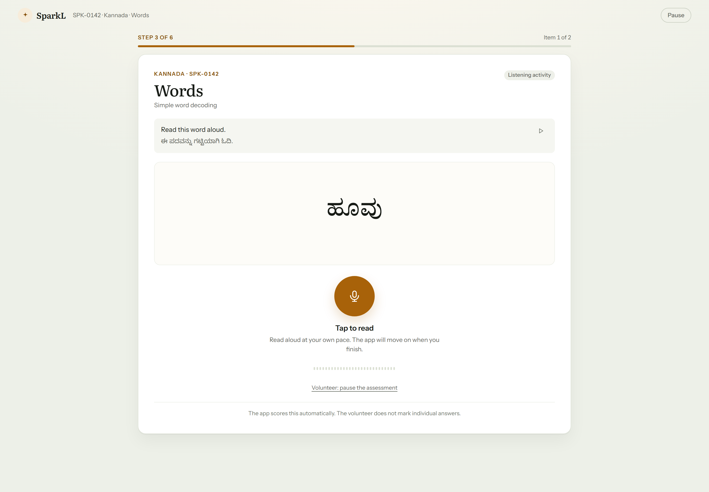
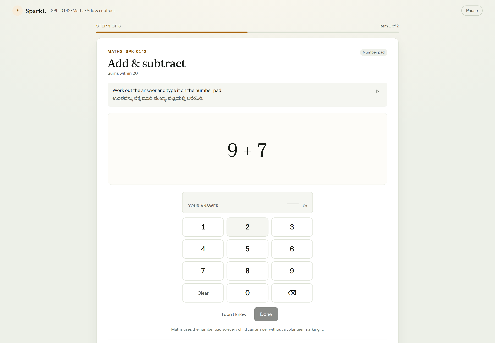
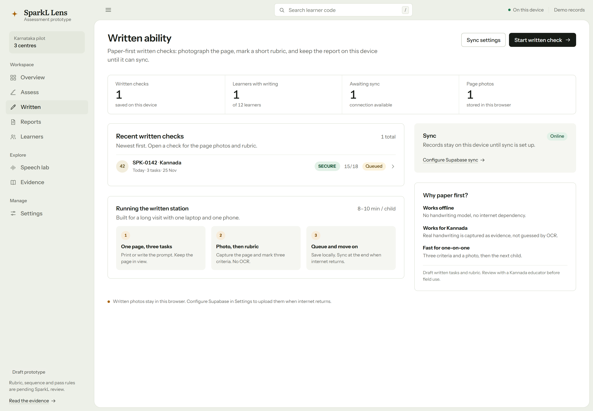
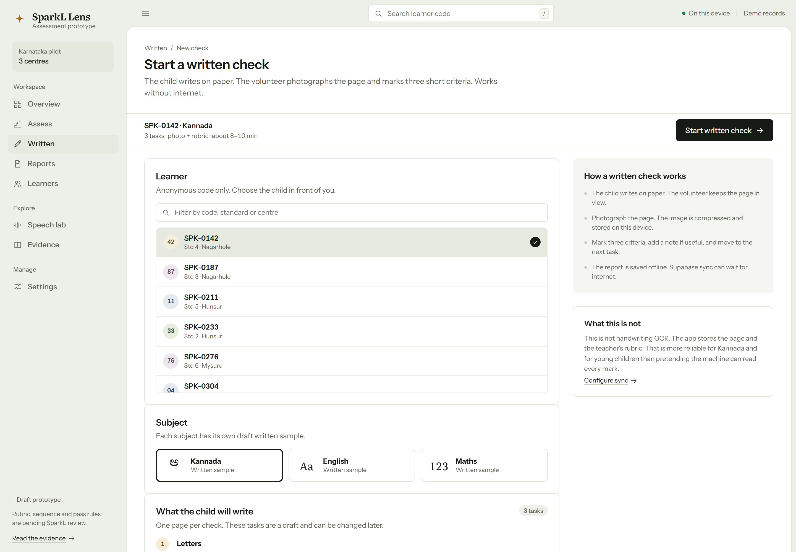
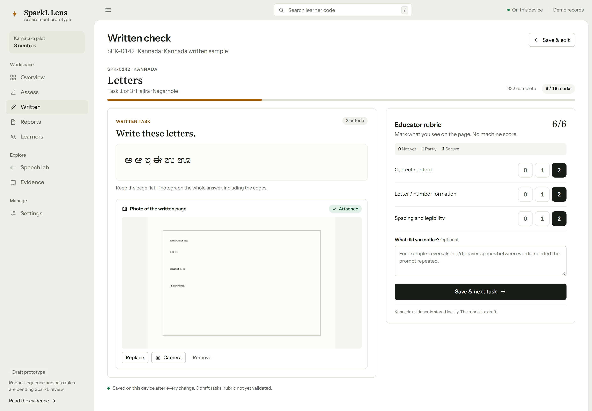
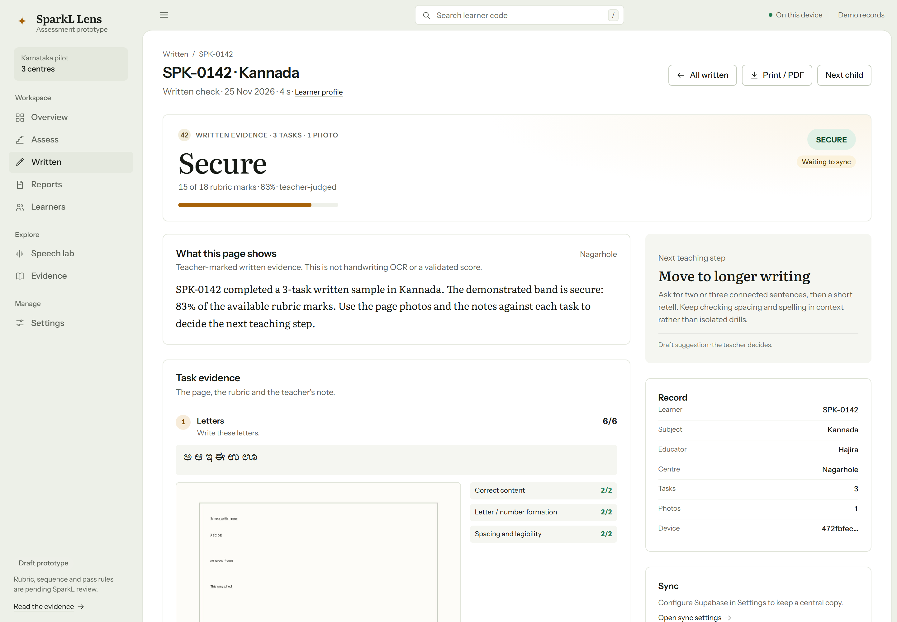

# SparkL Lens

A local-first field assessment app for **Project SparkL**. It supports the existing verbal/reading assessment and adds a **paper-first written assessment** for Kannada, English and Maths.

The field context is two NGO school visits a year, roughly eight hours of one-on-one time, one laptop, one phone and unreliable internet. SparkL Lens is therefore built to work offline first: the app shell is cached, written pages are photographed and stored on the device, and records upload to Supabase when a connection returns.

> This is a prototype, not a validated SparkL assessment. The levels, written tasks, rubric and fluency thresholds are drafts. Written evidence is teacher-marked, not handwriting OCR.

---

## The field workflow

1. **Before the visit** — install the app on the laptop while internet is available. Optionally configure Supabase.
2. **At the school** — open the installed app. No connection is required for the verbal or written workflow.
3. **One-on-one written check** — the child writes on paper. The volunteer photographs the page, marks three criteria and moves to the next task.
4. **One-on-one verbal check** — use the existing automatic or educator-assisted reading flow.
5. **Later** — when the laptop or phone has internet, queued written reports and page photos upload to Supabase.

A written check is three short tasks and should take roughly **8–10 minutes per child**. A verbal quick check is roughly **5 minutes**.

### Devices

- The **laptop** is the primary device. Use its webcam or choose a photo from its filesystem.
- The **phone** can run the same installed app and use its camera. It syncs its own records when online.
- Offline transfer of photos from the phone to the laptop is **not automatic**. If the laptop has a camera, capture there; otherwise let the phone sync directly when internet returns.

---

## Screens

### Verbal assessment

<p align="center">
  
</p>

| | |
|:---:|:---:|
|  |  |
|  |  |
|  |  |
|  |  |

### Written assessment

| | |
|:---:|:---:|
|  |  |
|  |  |

### Evidence

| | |
|:---:|:---:|
|  |  |

---

## Tech stack

- React 19 + TypeScript, built with Vite 6.
- Installable PWA with a generated service worker and offline app shell.
- `localStorage` for learner, verbal and written metadata.
- **IndexedDB** for compressed written-page photos.
- Optional **Supabase** sync: REST for written records and Storage for photos.
- Browser Web Speech API for verbal reading capture.
- A child-operated number pad for maths answers and counting.
- Locally bundled fonts and the five source PDFs.

---

## Run it

```bash
npm install
npm run dev
```

Open **http://localhost:5173**.

For the installable/offline build:

```bash
npm run build
npm run preview
```

Open **http://localhost:4173**. Load it once online, then use it offline. The app registers the service worker only in the production build.

To test offline:

1. Open the preview URL once and wait for the app to load.
2. Reload once so the service worker controls the page.
3. Disconnect the network and reload.
4. Navigate to **Written** and complete a check. It should save locally.

---

## What is in it

| Screen | What it does |
| --- | --- |
| **Overview** | Cohort snapshot, learners with the widest gap, level spread, recent verbal reports and the evidence anchor. |
| **Assess** | Automatic or educator-assisted verbal assessment, with a browser/microphone/network preflight. |
| **Automatic session** | Child-led reading assessment. Speech handles reading, sounds and comprehension; maths uses a number pad. |
| **Written** | Dashboard of written checks, offline/sync status, page-photo counts and recent reports. |
| **Written setup** | Choose learner and subject, preview the three draft written tasks, and start a check. |
| **Written session** | One task at a time. Photograph the page, mark three criteria, add a note, then save and move on. |
| **Written report** | Band, rubric score, page photos, per-criterion marks, teacher note and next step. |
| **Reports** | Verbal reports dashboard with fluency mix, breakdowns, quick-check flags and filters. |
| **Learner profile** | Verbal subject cards and progress chart, plus the latest written evidence and links to both reports. |
| **Settings** | Grading, level map, item bank, **Supabase sync**, exports, privacy and reset. |

The app ships with **12 seeded learners**, **55 seeded verbal reports** and **8 speech trials**. Written checks start empty. The data is fictional and can be reset in **Settings → Data & privacy**.

---

## Written assessment

### Why paper first

Handwriting recognition for Kannada, especially children's akshara and early writing, is not reliable enough to score automatically. The written module therefore treats the page itself as the evidence:

1. The child writes on paper.
2. The volunteer photographs the page.
3. The app compresses and stores the image locally.
4. The volunteer marks three criteria from **0 to 2**.
5. The report stores the photo, marks and note.

This works offline, works for Kannada, and keeps the teacher in control.

### Draft tasks

Each subject has a three-task sample:

- **Kannada** — letters, words, one sentence
- **English** — letters, words, one sentence
- **Maths** — numbers, sums, number names

Each task has three criteria such as accuracy, formation, spacing, sentence structure, spelling or working. Scores are **0 = not yet**, **1 = partly**, **2 = secure**.

Draft band thresholds:

- **Secure:** 75% or more of available marks
- **Developing:** 45–74%
- **Emerging:** below 45%

These tasks and thresholds are a starting point. They should be reviewed by a Kannada educator and SparkL before a real visit.

### What is not automatic

- No handwriting OCR.
- No automatic scoring of written answers.
- No claim that a photo proves a child's full writing ability.
- No replacement for a teacher's judgement.

---

## Verbal assessment

The existing verbal flow remains:

- Six draft rungs per subject.
- Quick check: two items per rung, one to clear, up to four attempts.
- Full ladder: three items per rung, two to clear by default.
- Child-led automatic speech scoring, with an educator-assisted fallback.
- Accuracy, pace, pauses and confidence, with low-confidence items flagged.
- Detailed verbal reports and the existing reports dashboard.

Speech recognition uses the browser's Web Speech API. It may need network access, Chrome and a secure context. It is not offline speech recognition and has not been validated on the cohort. Maths uses the number pad and does not need speech.

---

## Offline and sync

### Offline

- The production build is an installable PWA.
- Workbox precaches the HTML, JS, CSS, fonts and icons.
- Learner metadata and written records live in `localStorage`.
- Written page photos live in IndexedDB as compressed JPEGs.
- The app requests persistent storage when a written check starts, where the browser supports it.

### Sync

Written records are marked **Queued** when saved. If Supabase is configured:

- Records and photos upload when online.
- The app tries pending uploads automatically after a new record and when the connection returns.
- **Sync now** in Written or Settings retries immediately.

Setup is in [`supabase/README.md`](supabase/README.md), with the SQL in [`supabase/schema.sql`](supabase/schema.sql).

**Current scope:** upload from the field device to Supabase. Pulling records back onto a second device, authentication and deletion policies are not implemented yet. The included RLS policies are permissive for a college prototype and must be tightened before real child data is uploaded.

---

## Data and privacy

- Learner records use anonymous codes, not names.
- Written page photos are sensitive child records. Keep the device protected and clear local data when it changes hands.
- Photos stay in this browser unless Supabase sync is configured.
- The Supabase anon key is stored in this browser. It is a public key, not a secret; RLS is the protection boundary.
- No audio is stored. Browser speech recognition may process audio externally.
- Consent is recorded as a flag, not a signed document.
- A JSON backup includes written metadata but **not** the page photos. Use Supabase or a device backup for the images.

---

## Project structure

```
src/
  data/
    curriculum.ts    verbal ladders and item bank
    written.ts       written task sets, criteria and bands
    evidence.ts      research content
    seed.ts          demo learners and verbal reports
  lib/
    autoAssess.ts    verbal transcript scoring and fluency
    reporting.ts     verbal report narrative
    photoStore.ts    IndexedDB photo storage and compression
    sync.ts          Supabase upload queue
    store.ts         localStorage app state
    useSpeech.ts     browser speech capture
  pages/
    Assess, Session, AutoSession, Reports, ReportDetail
    Written, WrittenSetup, WrittenSession, WrittenReport
    Learners, LearnerDetail, SpeechLab, Evidence, Settings
  components/
    SyncManager, PhotoCapture, shell, ladders, modal, toast, icons
supabase/
  schema.sql         written table, photo bucket and prototype RLS
  README.md          sync setup
public/
  docs/              five source PDFs
  fonts/             locally served fonts
  icon-*.png         PWA icons
docs/screens/        screenshots
```

---

## Prototype limits and next steps

- Validate the written rubric and task set with a Kannada educator.
- Add editable written task sets per class or standard.
- Run a real 8-hour visit and measure minutes per child, photo quality and sync reliability.
- Add a proper Supabase auth and RLS model before child data leaves the device.
- Add two-way sync and photo pull for a second device.
- Add import/restore for written photos.
- Test on the actual laptop, phone, camera and shared Wi-Fi/hotspot.
- Agree consent, retention and deletion policies with the NGO.
- Do not treat verbal or written results as validated learning outcomes yet.

---

## Credits

- Built from **Project SparkL — Team Syndicate**, Tasks 1–4 and the Skill Map (October–November 2026).
- Interface: **Instrument Sans**; reading content and level names: **Literata**; Kannada: **Noto Serif Kannada** and **Noto Sans Kannada**.
- No analytics or tracking. Browser speech recognition and optional Supabase sync are the only network-backed features.

---

© 2026 Team Syndicate — Project SparkL. Prototype for college review; not intended for production use.
