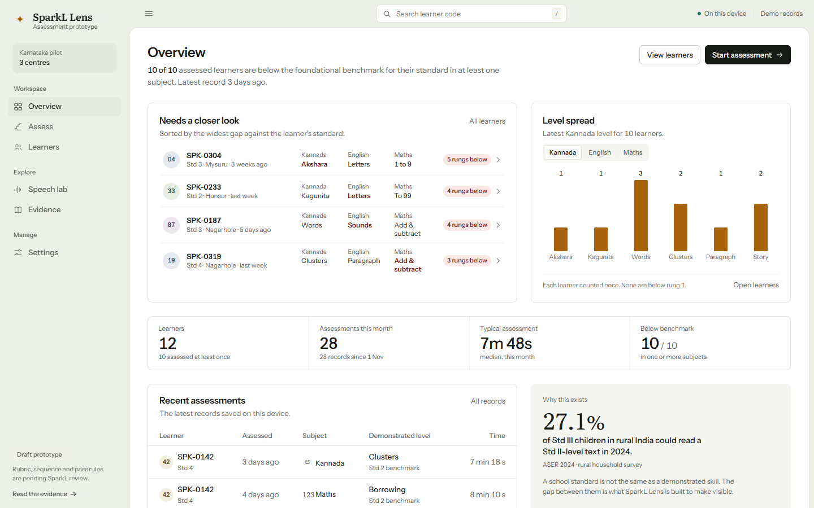
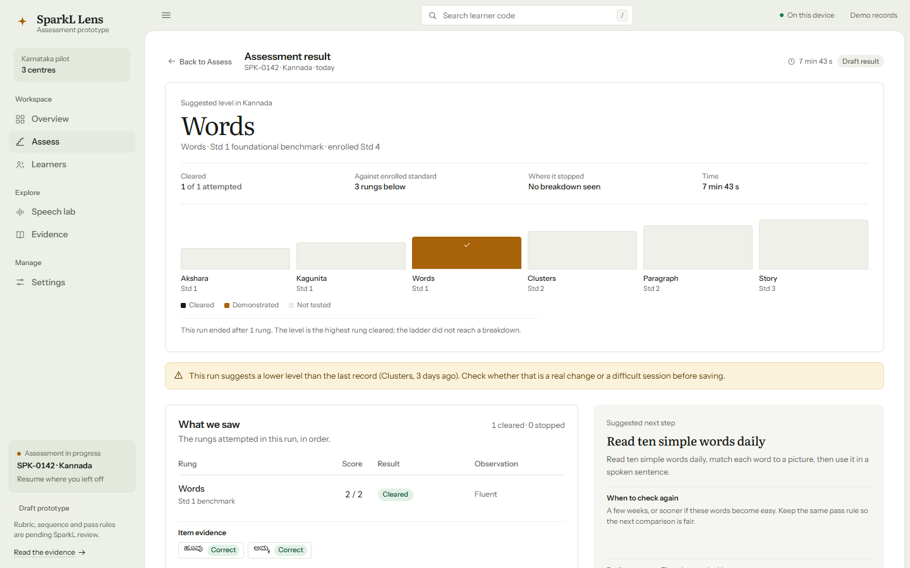
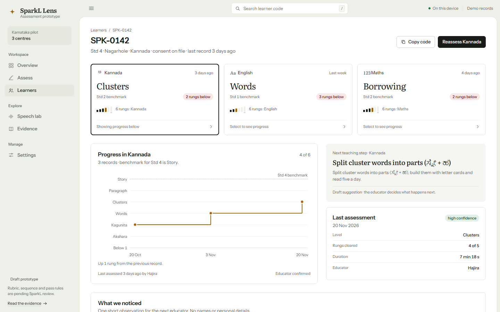
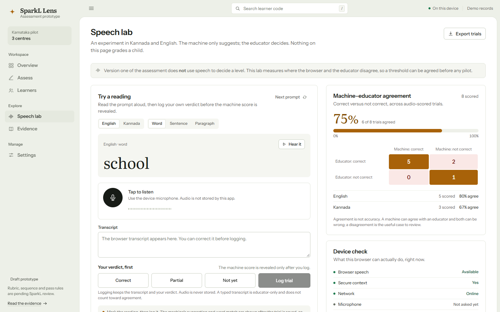

# SparkL Lens

A local-first draft assessment tool for **Project SparkL**. It finds a child's demonstrated level in **Kannada, English and Maths**, keeps the educator in control of every mark, and shows the gap between the level and the enrolled standard.

> This is a prototype, not a validated SparkL assessment. The ladder, benchmarks and pass rules are a working draft, and the learner records are seeded demo data.

---

## College review: five-minute walkthrough

1. **Overview** — start with the finding: 10 of 10 assessed learners sit below the foundational benchmark for their standard in at least one subject. Point to the widest gaps and the level spread.
2. **Assess** — pick the default learner (`SPK-0142`), keep Kannada and the quick check, and press **Begin assessment**. Read the word aloud; mark the first two items; open the rung review.
3. **Result** — show the level ladder, the point where the run stopped, the item evidence, the draft teaching step, and the educator override. Save the assessment, then open the learner profile to show the progress history.
4. **Speech lab** — switch between English and Kannada. Log a typed trial as an educator-only trial, or record a real reading. Point to the agreement matrix and the device check; explain that the machine never decides a level.
5. **Evidence** — open the source PDFs and show how Tasks 1–4 became the product: the ASER evidence, six interviews, seven existing tools, and the proposed approach.
6. **Settings** — change the pass rule or a benchmark, add a custom item, then restore the demo data.

Everything shown is demo data stored in the presentation browser. There is no shared account or real child record.

---

## Screens

_Demo build with the seeded cohort._

<p align="center">
  
</p>

| | |
|:---:|:---:|
|  |  |
|  |  |
|  |  |

---

## Tech stack

- React 19 + TypeScript, built with Vite 6.
- No backend, database, analytics or tracking.
- `localStorage` for records; JSON/CSV export for backups.
- Browser Web Speech API for optional English/Kannada speech recognition.
- Locally bundled fonts (Instrument Sans, Literata, Noto Kannada) and the five source PDFs.
- Node 20+ recommended for the build tooling.

---

## Run it

```bash
npm install
npm run dev
```

Open **http://localhost:5173**.

For the built version:

```bash
npm run build
npm run preview
```

Open **http://localhost:4173**.

The app is a static Vite/React app. There is no server, login or external database. Built files are in `dist/`; the five source PDFs and local fonts are copied from `public/`.

---

## What is in it

| Screen | What it does |
| --- | --- |
| **Overview** | Cohort snapshot, learners with the widest gap, level spread, recent assessments and the evidence anchor. |
| **Assess** | Choose an anonymous learner, subject and test length. Begin a quick check, the full ladder or a custom test. |
| **Session** | One item at a time. Speech capture is optional and advisory; the educator marks every response, sees the fluency/support, and confirms the rung. |
| **Result** | Suggested level, full ladder, item evidence, the point where the ladder stopped, a draft teaching step, and an educator override before saving. |
| **Learners** | Anonymous-code directory with subject levels, gaps, centre filters and CSV export. |
| **Learner profile** | Subject cards, a step chart over time, the last assessment, teaching step, notes and full history. |
| **Speech lab** | A Kannada/English comparison experiment. The educator marks first; a trial is logged and only then is the machine suggestion revealed. Agreement is shown per language and in a 2×2 matrix. |
| **Evidence** | The four task notes made browsable: ASER numbers, stakeholders, interviews, existing tools, case studies, the proposed approach, hard questions and team. |
| **Settings** | Editable pass rule, Kannada instruction toggle, level/benchmark map, item bank with custom items, export, reset/clear and privacy notes. |

The app ships with **12 seeded learners**, **55 seeded assessments** and **8 speech trials** so the cohort screens are not empty. The data is fictional. Reset it at **Settings → Data & privacy → Restore demo**, or clear it entirely.

The five PDFs are available from **Evidence → Source notes**, including the Team Syndicate skill map.

---

## How the assessment works

- Each subject has six draft rungs.
- **Quick check** starts one rung below the latest level, uses 2 items per rung, needs 1 to clear, and stops after 4 rung attempts. It is a triage estimate.
- **Full ladder** starts at rung 1 and uses the editable default (3 items, 2 to clear).
- **Custom test** lets the educator set the start rung, items, pass mark and attempt limit for one child.
- If the first rung is not cleared, the ladder **drops one rung** to check the level below before recording a result. The result keeps the failed rung as the breakdown edge.
- A partial response counts as half a point by default. All of this can be changed in **Settings → Grading**.
- The **educator confirms or overrides the final level** on the result screen. The app never saves a level automatically.

### Kannada

Kannada has its own sequence rather than English questions in Kannada script:

`akshara → kagunita → simple words → cluster words → paragraph → story`

The akshara, kagunita, word, cluster, paragraph and story items are in `src/data/curriculum.ts`. The sequence is a draft and must be reviewed by a Kannada educator and SparkL. The interface is English; instructions and item content switch to Kannada.

### Speech

Speech recognition uses the browser's Web Speech API (`kn-IN` and `en-IN`) and is **optional**:

- The educator can always mark manually.
- The machine's suggestion is hidden until the educator has marked the item, so it does not lead the judgement.
- It is shown after the mark as a secondary comparison. It never decides the level.
- Chrome may send microphone audio to its speech service. **SparkL Lens does not record or upload audio**; it stores only the transcript that is logged.
- Test on the actual shared Android device before promising speech support. Offline recognition is not implemented.

Recommended for speech testing: Chrome on `localhost`, with microphone permission allowed.

---

## Data and privacy

- Records are stored in **`localStorage`** under `sparkl-lens-db-v1` in this browser profile.
- Only an **anonymous learner code**, enrolled std, centre, home language, consent flag, notes, assessment results and speech transcripts are stored.
- No names, photographs, dates of birth, audio or server-side data are stored.
- Consent is recorded as a yes/no flag, not as a signed document.
- A shared browser profile means shared records. Use a dedicated device profile, export after a session and clear when the device changes hands.
- Export JSON or CSV from **Settings → Data & privacy**. This prototype does not import a JSON backup.
- The browser's speech service may process audio externally; that is disclosed in the Speech lab and Settings.

This is a prototype. It is not a production child-data system and has no authentication, sync, recovery or access control.

---

## Project structure

```
src/
  data/
    curriculum.ts    draft ladders and item bank
    evidence.ts      all research content used by the Evidence page
    seed.ts          demo learners, assessments and speech trials
  lib/
    store.ts         localStorage-backed store and actions
    session.ts       ladder/quick/full session helpers
    scoring.ts       transcript matching and numeric answer checks
    selectors.ts     cohort and learner calculations
    useSpeech.ts     Web Speech API, mic level, TTS
    export.ts        CSV/JSON exports
  pages/             Overview, Assess, Session, Learners, LearnerDetail,
                     SpeechLab, Evidence, Settings
  components/        shell, ladders, modal, toast, chart, tokens
public/
  docs/              the five source PDFs
  fonts/             locally served open-source fonts
```

---

## Prototype limits and next steps

- Obtain SparkL's official rubric, level names, pass rules and borderline rules.
- Have a Kannada educator approve the akshara/kagunita sequence, examples and instructions.
- Observe a real assessment; measure minutes, errors and the current paper/Excel process.
- Test airplane mode, low battery, shared-device use, Kannada rendering and reopening saved results on the **actual device**.
- Agree a speech accuracy threshold with SparkL before any automated suggestion is treated as more than advisory.
- Decide the partner school, centre, education board and data/consent process.
- Add import, authentication, safe sync and access control before any field use.

The research behind each of these points is on the **Evidence** screen and in `public/docs`.

---

## Credits

- Built from **Project SparkL — Team Syndicate**, Tasks 1–4 and the Skill Map (October–November 2026).
- Interface: **Instrument Sans**; reading content and level names: **Literata**; Kannada: **Noto Serif Kannada** and **Noto Sans Kannada**. All are open-source and served locally.
- No analytics, no tracking, no remote API calls are made by the app itself. Browser speech recognition is the one feature that may use the browser vendor's online service.

---

© 2026 Team Syndicate — Project SparkL. Private prototype for college review; not intended for reuse or production use.
